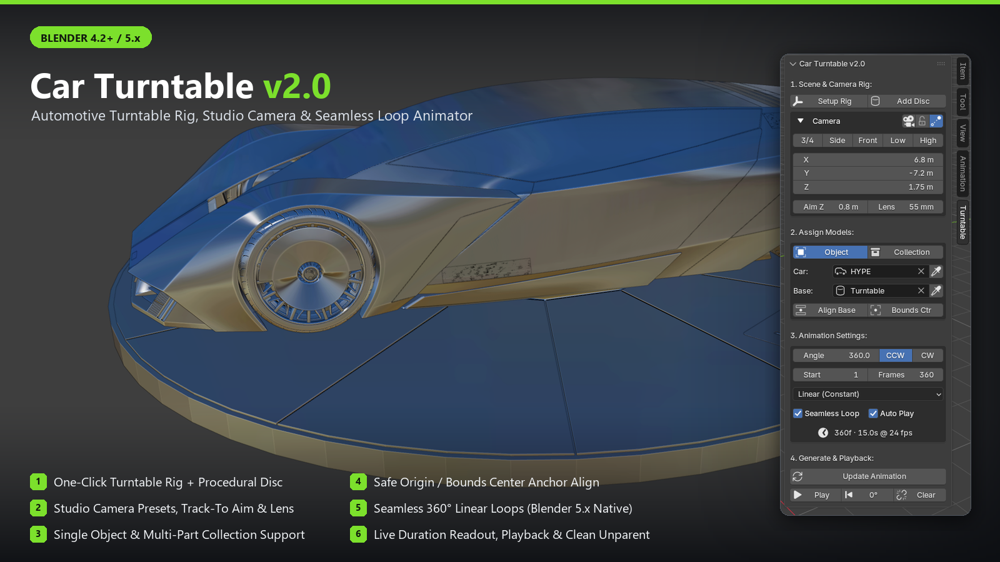
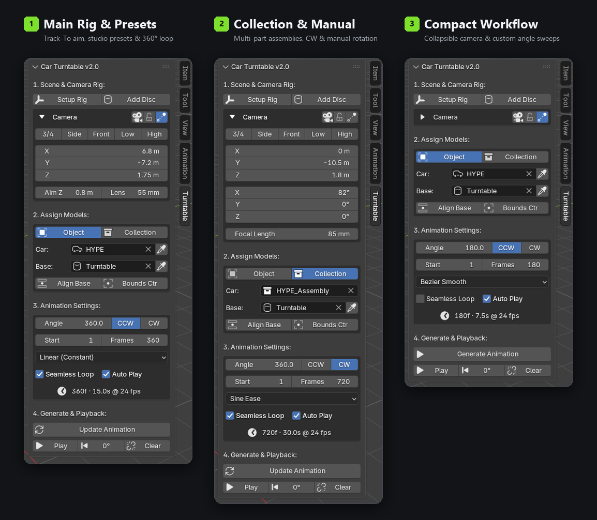
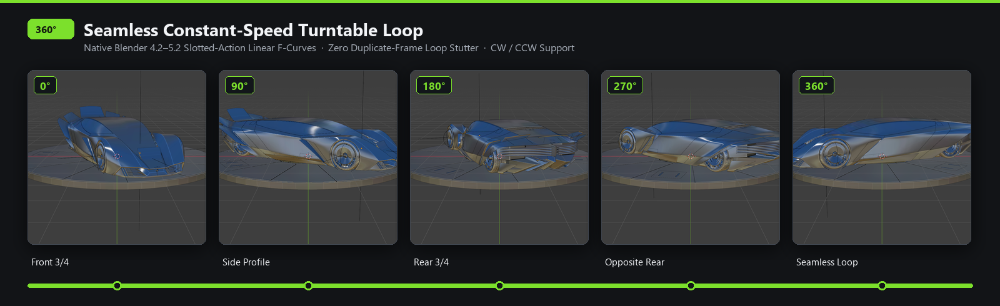

# Car Turntable Generator v2.0



A streamlined **Blender 4.2+ / 5.x Extension** built for automotive presentation & turntable showcase workflows. Automates turntable rig setup, procedural showroom platform generation, studio camera framing with Track-To aim, multi-part car Collection parenting, and seamless 360° constant-speed loop animation from a single N-Panel (`View 3D > N > Turntable`).

- **Author:** `wbwbwb`
- **Compatibility:** Blender **4.2+** (tested on **Blender 4.5.15 LTS** & **Blender 5.2.3 LTS**)
- **License:** GPL-3.0-or-later

---

## UI Overview



---

## Features

### 1. Scene & Camera Rig (1-Click Setup + Procedural Disc)
- **Setup Rig (`ctg.setup_turntable`):** Creates (or safely restores without duplicating) `Turntable_Anchor`, `Turntable_Target`, and `Turntable_Camera`, working cleanly even when called from Edit Mode.
- **Add Disc (`ctg.create_disc`):** Generates a sleek beveled showroom turntable platform with its top surface seated at `Z = 0.0` (with F9 Redo controls for `Radius`, `Height`, `Segments`, and `Top Bevel`).
- **Studio Camera Presets:** One-click automotive framing angles — **`3/4`** (55mm), **`Side`** (85mm), **`Front`** (85mm), **`Low`** (50mm), and **`High`** (55mm).
- **Track-To Aim & Quick Viewport Controls:** Toggle `TRACK_TO` aim with live **Aim Z** height adjustment, **Focal Length (`mm`)**, **Camera View (`Numpad 0`)**, and **Lock Camera to View** directly in the panel.

### 2. Assign Models (Object & Multi-Part Collection Support)
- **Object Mode:** Assign a single car mesh/Empty and turntable base with 1-click **Pick Active Object** eyedroppers.
- **Collection Mode:** Assign an entire multi-part automotive **Collection** (body, wheels, glass, calipers, interior) — automatically parents only top-level objects so internal sub-hierarchies are never broken.
- **Safe Anchor Alignment:** Align `Turntable_Anchor` to **`Align Base`** (world origin) or **`Bounds Ctr`** (XY center + bottom Z) while preserving all already-parented children's exact world transforms.

### 3. Seamless 360° Animation Settings (Blender 5.x Native)
- **Blender 4.2–5.2 Native F-Curves:** Supports Blender 4.4+/5.x Layered/Slotted Actions (`action_get_channelbag_for_slot` / `layers → strips → channelbags`) alongside legacy `action.fcurves` so **Linear (Constant)** rotation works reliably across every version.
- **Seamless Loop:** Automatically places the final 360° keyframe on `frame_end + 1` so looping playback has zero duplicate-frame stutter.
- **Flexible Motion Controls:** Configurable **Angle (°)**, **`CCW` / `CW`** spin direction, **Start Frame**, **Frame Count**, **Motion Curve** (`Linear (Constant)`, `Sine Ease`, `Bezier Smooth`), **Auto Play**, and live duration readout (`360f · 15.0s @ 24 fps`).



### 4. Generate & Playback Controls
- Smart **Generate / Update Animation** button parents models cleanly, updates keyframes, and starts playback without accidentally pausing already-running playback.
- Instant playback strip: **Play / Pause**, **Reset `0°`**, and non-destructive **Clear** (unparents models preserving exact world transforms and clears keyframes so you can jump straight back to modeling).

### 5. Included Asset: Turntable Mock-Up Model (`Turntable.blend`)
- The attached **`Turntable.blend`** file ([assets/Turntable.blend](assets/Turntable.blend) and attached to the [Latest Release](https://github.com/Gregrioum/Car-Turntable-Generator/releases/latest)) includes a ready-to-use **automotive showroom turntable mock-up model** (~5.58 m diameter multi-part platform parented to a `Turntable` root Empty with stainless steel, chrome, and anti-slip metal materials).
- Open `Turntable.blend` directly (or append the `Turntable` hierarchy into your car scene), assign `Turntable` to the **Base** slot, and generate a 360° showcase right away.

---

## Installation (Blender 4.2+)

1. Download **`Car_Turntable_Generator_v2.0.zip`** (and optionally **`Turntable.blend`**, which contains the turntable mock-up model) from the [Latest Release](https://github.com/Gregrioum/Car-Turntable-Generator/releases/latest) page.
2. In Blender, either:
   - **Drag and drop** the `.zip` file directly into the Blender window, **or**
   - Go to **`Edit > Preferences > Get Extensions`**, click the top-right dropdown (`v`), and choose **`Install from Disk...`**.
3. Open the 3D Viewport sidebar (**`N`**) and select the **`Turntable`** tab.

---

## Building from Source

Using Blender's official Extension CLI (Blender 4.2+):

```bash
blender --command extension build --source-dir ./car_turntable_generator --output-filepath ./Car_Turntable_Generator_v2.0.zip
```

Validate the built package:

```bash
blender --factory-startup --command extension validate ./Car_Turntable_Generator_v2.0.zip
```

---

## Changelog

See [CHANGELOG.md](CHANGELOG.md) for the full version history.

## License

Licensed under the **GNU General Public License v3.0 or later** — see [LICENSE](LICENSE) for details.
